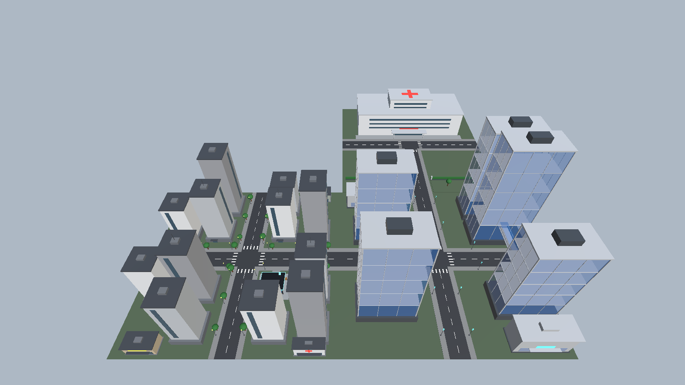

# 基于 Unity 的八维通未来社区智能配送机器人虚拟仿真软件

> 2023 级数字媒体技术专业毕业设计 · Unity 6 虚拟仿真项目

## 项目简介

本项目面向未来社区中的智能配送场景，使用 Unity 搭建可交互、可扩展的社区数字沙盘，为配送机器人的路径规划、任务调度和运行验证提供虚拟仿真环境。

当前版本已完成三个相邻地块的基础白模与场景骨架：

- **District_01 住宅区**：100 × 100 m，包含十字道路、12 栋住宅楼、低矮商业配套、社区配送站、路灯与行道树。
- **District_02 商业科技区**：100 × 100 m，包含 5 栋蓝色半透明玻璃板楼、3 条空中连廊、2 个银色商业综合体和未来感路灯。
- **District_03 医疗区**：100 × 100 m，包含 T 字路口、大型白色医院综合体、屋顶红十字，以及与商业区之间的绿化隔离带。

三个地块组成约 200 × 200 m 的 L 形社区，道路在边界处无缝衔接。后续将在此基础上接入配送机器人模型、NavMesh 寻路、配送任务状态机与可视化交互。



## 核心内容

- 三地块 L 形社区沙盘，地块尺寸统一为 100 × 100 m。
- 主干道、T 字路口、人行道、斑马线、中心虚线和道路衔接。
- 住宅、商业、医疗三类建筑体块与差异化材质风格。
- 社区配送站：蓝色主体、入口三级台阶、发光顶棚、机器人停靠圆盘、充电桩与入口锚点。
- 商业区空中连廊：Y = 15 m，两端嵌入塔楼，玻璃桥体 + 银色桥底板。
- 大型医院：白色主楼、中央塔楼、屋顶红十字、入口雨棚与绿化隔离带。
- 高俯瞰主相机，可一次查看三个地块。

## 技术栈

| 类别 | 技术 / 版本 |
|---|---|
| 游戏引擎 | Unity **6000.3.9f1**（Unity 6.3） |
| 渲染管线 | Universal Render Pipeline **17.3.0** |
| 输入系统 | Unity Input System **1.18.0** |
| 导航 | Unity AI Navigation **2.0.10**（已安装，寻路功能待接入） |
| 编辑器自动化 | `com.unity.pipeline` **0.9.1-exp.1** |
| MCP | Unity Pipeline 命令通道 + MCP 工具链 |
| AI 辅助开发 | DeepSeek Harness |
| 编程语言 | C# |
| 版本管理 | Git + GitHub |

> MCP（Model Context Protocol）用于将 Unity 编辑器能力暴露给 AI 工具链；DeepSeek 用于辅助脚本生成、场景批量构建、代码检查和文档整理。核心场景结构、功能逻辑与最终实现由项目开发者负责。

## 场景入口

主场景：

```text
Assets/Scenes/FutureCommunity_Blockout.unity
```

其他场景为历史实验或模板场景，不作为当前主入口：

- `Assets/Scenes/FutureCommunityCrossroad.unity`
- `Assets/Scenes/Main.unity`
- `Assets/Scenes/SampleScene.unity`

## 目录结构

```text
My project/
├─ Assets/
│  ├─ Scenes/
│  │  └─ FutureCommunity_Blockout.unity   # 主场景
│  ├─ Editor/
│  │  └─ FutureCommunityBlockoutBuilder.cs # 程序化白模生成器
│  ├─ Materials/
│  │  └─ FutureCommunityBlockout/          # 场景专用材质
│  ├─ Prefabs/                             # 预制体资源
│  ├─ Resources/                           # 导入的第三方模型与素材
│  ├─ Road/                                # 道路相关预制体
│  ├─ Settings/                            # URP 渲染配置
│  ├─ Screenshots/                         # 各阶段效果截图
│  └─ TutorialInfo/                        # Unity 模板说明
├─ Docs/
│  ├─ Requirement.md                       # 需求说明书
│  └─ DevLog.md                            # 开发日志
├─ Packages/
│  ├─ manifest.json
│  └─ packages-lock.json
├─ ProjectSettings/
├─ .gitignore
└─ README.md
```

## 场景层级

```text
FutureCommunity_Blockout（District_01 住宅区）
├─ Ground_100x100
├─ Roads
├─ Sidewalks
├─ RoadMarkings
├─ ResidentialBuildings（12 栋）
├─ CommercialBuildings（3 栋）
├─ DeliveryStation
└─ StreetFurniture
   ├─ StreetLights（24 盏）
   └─ StreetTrees（21 棵）

District_02_Expansion（商业科技区）
├─ Ground_100x100_District02
├─ Roads
├─ Sidewalks
├─ RoadMarkings
├─ BlueGlassTowers（5 栋板楼）
├─ Skybridges（3 条）
├─ SilverCommercialComplexes（2 个）
└─ FutureStreetLights（16 盏）

District_03_Medical（医疗区）
├─ Ground_100x100_District03
├─ Roads（T 字路口）
├─ Sidewalks
├─ RoadMarkings
├─ MedicalBuffer（绿化带、绿篱、门柱）
└─ HospitalComplex（大型医院）

Directional Light / Fill Light / Main Camera
```

## 关键坐标

| 对象 | 位置 / 参数 |
|---|---|
| District_01 中心 | `(0, 0, 0)` |
| District_02 中心 | `(100, 0, 0)` |
| District_03 中心 | `(100, 0, 100)` |
| T 字路口 | 世界坐标 `(100, 0, 100)` |
| 配送站 | 世界坐标 `(16, 0, -16)` |
| 配送站入口锚点 | `(9.8, 0.2, -13)` |
| 医院主楼 | 约 `76 × 30 × 18 m`，范围 X 62–138、Z 112–142 |
| Main Camera | `(50, 150, -100)`，旋转 `(45°, 0, 0)`，FOV `60°` |

## 快速开始

1. 克隆仓库并安装 **Unity 6000.3.9f1**。
2. 在 Unity Hub 中添加项目根目录。
3. 打开主场景：

   ```text
   Assets/Scenes/FutureCommunity_Blockout.unity
   ```

4. 进入 Play Mode 或直接在 Scene 视图中检查场景。
5. 当前主相机为静态高空俯瞰视角，可在编辑器中自由移动 Scene 视图查看局部。

### 重新生成白模

菜单入口：

```text
Tools → Future Community → Build Blockout Scene
```

该操作会重新创建一个完整场景并保存到主场景路径，**会覆盖当前场景中的手工修改**。执行前请先保存或备份场景。

## 开发路线

- [x] 三地块社区白模与道路网络
- [x] 住宅区、商业科技区、医疗区建筑体块
- [x] 商业区板楼与空中连廊
- [x] T 字路口与大型医院
- [x] 社区配送站与入口锚点
- [ ] 配送机器人模型、材质与动画
- [ ] NavMesh 烘焙与机器人寻路
- [ ] 配送任务状态机与多点配送
- [ ] 运行 HUD、任务面板与路径可视化
- [ ] 性能测试与答辩演示脚本

## 文档

- [需求说明书](Docs/Requirement.md)
- [开发日志](Docs/DevLog.md)

## 版本管理

项目使用 Git 进行版本管理，远程仓库：

https://github.com/Moyu-z/Eight-Dimensional-Community-Delivery-Robot

提交规范采用 Conventional Commits 风格，例如：

```text
feat: 完成商业区板楼与空中连廊
docs: 添加 README、需求说明书及首日开发日志
fix: 修复道路接缝处的材质错位
```

## 第三方素材说明

`Assets/Resources/` 中包含用于原型验证的第三方模型与贴图素材（如 Kenney 资源包），其版权归原作者所有，仅用于本毕业设计的教学与演示。正式发布前需按对应素材许可进行确认或替换。
